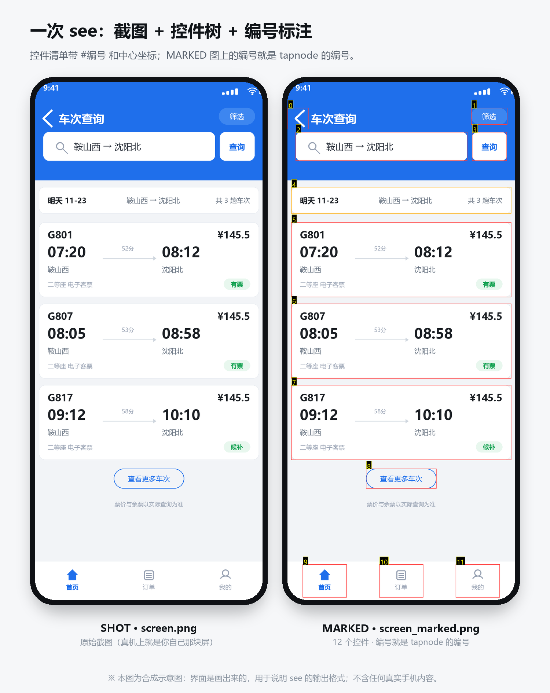

# phone-control

[](https://github.com/misila122/phone-control/actions/workflows/ci.yml)
[](LICENSE)
[](https://www.python.org/)

用 ADB 把一台**真实的安卓手机**变成 AI 能「看见」也能「动手」的设备：
`see` 一次同时拿到截图 + 无障碍控件树（带编号和精确坐标），再用 `tapnode` / `text` /
`key` / `launch` 完成任务。**不 Root，不在手机上装自动化 App。**

它有两种用法：

- 做一个 **Agent Skill**：`SKILL.md` 是给 Agent 看的技能说明书，`scripts/phone.py` 是唯一要被执行的脚本；
- 做一个**独立命令行工具**：不接任何模型，直接在终端里用（本文所有例子都是这个形态）。



> 上图是**合成示意图**（`tools/make_demo_image.py` 画出来的假界面，标注图由脚本里真正的
> `annotate()` 生成），只用来说明 `see` 的输出长什么样，不含任何真实手机内容。
> 想不接手机先离线看一遍：`python scripts/phone.py replay --from examples`。

---

## 一、它解决什么问题

让模型（或人）去操作手机，常见有三条路，代价各不相同：

| 做法 | 优点 | 代价 |
|---|---|---|
| 纯看截图的视觉方案 | 什么界面都能「看」 | 坐标靠估，换分辨率 / 动画中 / 小按钮就点偏；烧 token |
| 手机上装无障碍服务 App | 不依赖电脑 | 要装 App、要授权、自己维护；不易随 Agent 分发 |
| **ADB + 控件树（本项目）** | 不 Root、不装 App、坐标精确、单文件脚本 | 要开调试（USB 或无线）；同一时间只能被一个 adb 客户端控制 |

具体做法是「两路一起看」：

- **控件树**（`uiautomator dump`）给每个控件的 `text / content-desc / resource-id / bounds`，
  点的时候直接用控件中心坐标，不受屏幕缩放和视觉估计影响；
- **截图**给人和 Agent 做二次确认，也兜住控件树拿不到的地方 —— 游戏、Flutter 自绘、
  视频、Canvas、WebView 里的部分内容，控件树是空的，那时只能看图 + 9 宫格估坐标。

---

## 二、快速开始

### 1. 前置

| 依赖 | 说明 |
|---|---|
| Python 3.9+ | 只跑脚本，没有第三方包也能用（纯标准库） |
| `adb` | Android platform-tools 里的那个。装在 PATH 里即可；装在别处就设环境变量 `PHONE_ADB` 指过去 |
| Pillow（可选） | 只影响「编号标注图」`MARKED`；没装也能用，只是没有标注图 |

```bash
python scripts/phone.py doctor     # 第一次先跑这个：看 adb / 设备 / 截图 / 控件树 是否都 OK
```

看到 `截图 : OK` 和 `控件树 : OK` 才继续。没有设备时脚本会直接把三种接法打印出来。

### 2. 把手机连上

1. **USB（最稳）**：设置 → 关于手机 → 连点「版本号」7 次 → 开发者选项 → 打开「USB 调试」→ 手机上点「允许调试」。
2. **无线（Android 11+，推荐）**：手机和电脑同一 Wi-Fi → 无线调试 → 「使用配对码配对装置」→
   记下弹窗里的 **6 位配对码** 和 **ip:配对端口** →
   `python scripts/phone.py pair <ip>:<配对端口> <配对码>` →
   回上一页读 **「IP 位址和連接埠」** 里**另一个**端口 → `python scripts/phone.py connect <ip>:<连接端口>`。
3. **无线（旧）**：USB 已连上时 `python scripts/phone.py wireless`，拔线后它就挂在 TCP 上了。

多台设备在线时，命令加 `-s <serial>`，或设 `PHONE_SERIAL`；工作目录用 `--work` 或 `PHONE_WORK` 改
（默认在系统临时目录下，Windows 上是 `%TEMP%\phone-control\<serial>`）。

### 3. 核心循环：看 → 定 → 做 → 验

```bash
python scripts/phone.py see                 # ① 看：截图 + 控件树 + 编号标注图
python scripts/phone.py see                 #    （真机上会打印 SHOT / MARKED / TREE 三行路径）
python scripts/phone.py find 登录            # ② 定：按文本找控件，记下编号
python scripts/phone.py tapnode 12          # ③ 做：点第 12 号控件（用控件树里的精确坐标）
python scripts/phone.py see                 # ④ 验：重新看一屏，确认动作真的生效了
```

三条硬规矩，比命令本身更重要：

1. **每一步都要重新观测**。禁止连续盲点、禁止「点三下同一个坐标赌它生效」；同一目标失败两次就换策略。
2. **控件树优先**。只有树里缺目标时才看 `SHOT` 视觉定位；必要时 `see --grid` 叠 10% 网格。
3. **一次只做一个动作**，动作后默认等 1 秒（`--wait` 可调），再做下一次 `see`。

### 4. 一个完整任务长什么样

用户说「帮我在高德上查一下明天从鞍山到沈阳的高铁」：

```bash
python scripts/phone.py doctor
python scripts/phone.py launch com.autonavi.minimap
python scripts/phone.py see            # 看首页控件，找到「搜索」入口编号
python scripts/phone.py tapnode 7      # 点搜索框
python scripts/phone.py text "鞍山到沈阳 高铁"   # 中文自动走 ADBKeyboard
python scripts/phone.py key enter
python scripts/phone.py waittext 沈阳 --timeout 20
python scripts/phone.py see            # 读结果页车次/时间，汇报
```

只有「提交订单、支付、发送、删除」这类动作要停下来向用户确认。

### 5. 不插手机也能先跑一次

`examples/` 里放了一套**合成**的离线快照（截图 + 控件树），用来在没设备时核对界面结构和坐标：

```bash
python scripts/phone.py replay --from examples
python scripts/phone.py parse examples/ui.xml     # 只解析控件树，不连设备
```

`replay` 只读磁盘，不会执行任何动作 —— 它是「看」的离线模式，不能替代真机跑任务。

---

## 三、命令速查

| 目的 | 命令 |
|---|---|
| 观测一屏（截图 + 控件树 + 标注图） | `see`（`--grid` 叠网格、`--no-mark` 不生成标注图） |
| 只截图 / 只控件树 | `shot` / `dump` |
| 按文本找控件（会落快照供 tapnode） | `find 登录`（`--mode exact` 精确匹配） |
| 点控件 / 点坐标 | `tapnode 12` / `tap 540 1200` |
| 长按 / 滑动 / 滚动 | `long 540 1200 --ms 800` / `swipe 540 1800 540 600 300` / `scroll down --times 3` |
| 输入文字（中文/表情自动处理） | `text "搜索内容"` |
| 按键 | `key back`（back/home/recents/enter/del/tab/power/wakeup/volume_up…，也支持数字 keycode） |
| 启动 App / 打开深链 | `launch com.tencent.mm` / `open "https://..."` |
| 跳系统设置页 | `intent -a android.settings.WIFI_SETTINGS`（更多见 `references/apps.md`） |
| 等某文本出现 | `waittext 支付成功 --timeout 30` |
| 前台是谁 / 分辨率 | `info` |
| 查包名 | `apps --find wechat`、`apps`（默认只列第三方，`--all` 列全部） |
| 连接 / 配对 / 转无线 | `connect <ip:port>` / `pair <ip:pairport> <码>` / `wireless` |
| 输入法状态 / 装 ADBKeyboard | `ime status` / `ime install` / `ime restore` |
| 全链路自检 / 离线解析 | `selftest` / `parse <xml>` |

场景化的套路（搜索三件套、列表滚到底、表单、弹窗清场、微信里发消息……）见
[`references/recipes.md`](references/recipes.md)；常用 App 包名和系统设置页 intent 见
[`references/apps.md`](references/apps.md)。

---

## 四、作为 Agent Skill 装

```
phone-control/
├─ SKILL.md                 ← 技能说明书（带 name/description frontmatter，Agent 读它）
├─ scripts/phone.py         ← 唯一要执行的脚本
└─ references/              ← 被 SKILL.md 引用的资料（按需读，不占上下文）
```

- **Claude Code / 兼容 Agent Skills 的客户端**：把整个目录放到 `~/.claude/skills/phone-control/`
  （或项目里的 `.claude/skills/phone-control/`），技能会被自动发现。
- **豆包工作客户端**：放进它的 `.user_skills/` 目录（Windows 上一般在
  `…\Doubao\User Data\Default\.doubao\agent_mode\workspace\.user_skills\`）—— 这个项目最初就是从那里长出来的。
- **其它 Agent**：没有 skill 机制也行。把 `SKILL.md` 的内容作为系统提示附加，告诉它
  「需要操作手机时跑 `python scripts/phone.py <命令>`」即可。

为什么这样拆：`SKILL.md` 是**给模型看的**（怎么循环、什么不能做、踩过的坑），
`README.md` 是**给人看的**（怎么装、怎么排障、为什么这么设计）。改行为先改 SKILL.md。

---

## 五、安全边界（比功能重要，别跳过）

1. **涉及钱、消息、删除、发布、账号的操作必须先问用户**：支付/下单/转账/充值、
   发送消息/朋友圈/评论、删除数据、解绑/注销、改密码、批量授权。
2. **登录、验证码、人脸/指纹、支付密码停手** —— 这些必须用户本人在手机上完成。
3. **弹窗优先处理，但只点安全选项**：权限申请、青少年模式、更新提示能关就关；
   **绝不点「开通会员 / 免费试用 / 领取 / 一键安装」**。
4. **不装来路不明的 App、不 Root、不改与任务无关的系统设置**（时间、语言、开发者选项等）。
5. **只做用户要求的事**；跑完把界面留在任务完成页或用户能接手的位置。
6. **截图和控件树里是用户的隐私**（聊天、余额、地址、验证码）：只在任务需要时读，
   **不主动复述无关内容，不外传、不提交到仓库**。

> ⚠️ 自动化操作第三方 App **可能违反其用户协议**（尤其签到、刷量类），有封号风险。
> 默认建议用小号 / 自己的设备试；本项目的安全规则只是减少误操作，不构成对合规性的保证。
> 更完整的用途限制、责任划分和第三方组件说明见[第十四节](#十四免责声明与使用风险)。

---

## 六、中文与特殊字符输入

`text` 会自动分流，你不用管中间发生了什么：

- **纯 ASCII** 走 `input text`，整段用单引号包住（空格不会被拆成多个参数）；
- **中文 / 表情 / shell 元字符 / 换行** 走 ADBKeyboard 的 base64 广播：
  自动 `enable → set → 抢回焦点 → am broadcast → 切回原输入法`。

首次用到中文时如果报「需要 ADBKeyboard」，跑：

```bash
python scripts/phone.py ime install     # 默认走 ghfast.top 镜像（第三方加速，非官方源），国内可用
python scripts/phone.py ime status      # 核对装没装、当前输入法是谁
```

下载不到就手动把 `ADBKeyboard.apk` 传到手机装上，再 `ime install --local <apk路径>`。

两个容易踩的点，脚本已经处理了：**输入前必须先 tap 到输入框**（让它拿到焦点），以及
**输入后回读一遍控件树校验**（看到 `WARN:` 说明没写进去，不是「假装成功」）。ADBKeyboard 的命令行
输入还有个坑：`ime list -s` 看不到没启用的输入法、隐式广播 Android 8+ 收不到，所以脚本用
`ime list -a` 找组件、`am broadcast -p <包名>` 显式指定。

---

## 七、目录结构

```
phone-control/
├─ SKILL.md                    技能说明书：循环、命令速查、硬性规则、故障表
├─ README.md                   本文件（给人看的）
├─ LICENSE                     MIT
├─ scripts/
│  └─ phone.py                 唯一的执行入口（约 1000 行，纯标准库；Pillow 可选）
├─ references/
│  ├─ apps.md                  约 50 个常用 App 包名 + 系统设置页 intent
│  └─ recipes.md               8 类高频套路：搜索 / 滚到底 / 表单 / 弹窗 / 发消息 / 读屏……
├─ examples/                   合成离线快照（不用手机也能试 parse / replay）
│  ├─ screen.png               合成截图（tools/ 里画出来的）
│  ├─ screen_marked.png        编号标注图（真的 annotate() 生成的）
│  └─ ui.xml                   与画面一一对应的合成控件树
├─ tools/
│  └─ make_demo_image.py       重新生成 examples/ 和 assets/demo.png
├─ tests/
│  ├─ test_offline.py          19 个离线测试：控件树解析 / 编号 / 标签 / CLI / 懒加载 adb
│  └─ fixtures/                ui_sample.xml（12 个控件的样本）、ui_empty.xml
├─ assets/
│  └─ demo.png                 README 头图（合成示意图）
└─ .github/workflows/ci.yml    Ubuntu + Windows，Python 3.9–3.13
```

`examples/`、`assets/` 是生成物：**别手改**，改 `tools/make_demo_image.py` 后重新跑一次。
真机快照（`screen*.png`、`ui.xml`、`ui.json`、`*.apk`）在 `.gitignore` 里 —— 那些是用户屏幕内容。

---

## 八、设计取舍与踩过的坑

为什么是现在这个样子，几条当时想清楚的事：

1. **控件树优先，视觉兜底**。纯视觉方案要靠模型估坐标，换台分辨率不同的手机就点偏；
   控件树直接给 `bounds`，点击用中心点，稳定一个数量级。但游戏/Flutter/视频界面的树是空的，
   所以 `see` 永远同时产出 `SHOT`，并保留 `--grid` 给视觉估坐标用。
2. **每次动作后强制重新观测**。`tapnode` 读的是上一次 `see`/`find` 落盘快照，
   默认会警告「快照已 N 秒旧」；超过 45 秒就基本不可信。这不是啰嗦，是因为
   「点了没反应」的绝大多数原因是界面早变了 / 点在遮罩上。
3. **一次一个动作**。看着慢，实际上比「连点五下再检查」省时间 —— 后者经常点进广告或
   误触支付按钮。
4. **截图走 `exec-out screencap -p` 拿二进制**，不落手机、不经 PowerShell 重定向（那个会把
   PNG 编码毁掉）；失败再退回「存手机 → `adb pull`」。
5. **`uiautomator dump` 重试 3 次**，失败兜底 `cat` 远程 xml（个别机器 `pull` 权限受限）；
   刚启动/切页/动画中 dump 到 0 节点是正常的，等 1–2 秒再试。
6. **单文件 + 纯标准库**。Agent 拿到一个 `.py` 就能跑，不用建虚拟环境、不用 `pip install`；
   Pillow 只影响那张好看的标注图，缺了不影响「看」和「做」。
7. **adb 懒加载**。以前 `ADB = find_adb()` 写在模块顶层，没装 adb 的机器连 `--help` 都跑不了，
   也让 CI 没法离线测；现在只有真正要碰设备时才去找 adb，`--help` / `parse` / `replay` 都能离线用。
8. **快照落盘 + 离线 `replay`**。`see` 把 `screen.png` / `ui.xml` / `ui.json` 写到工作目录，
   `replay` 只读它们 —— 没设备时能校对界面结构，聊天里也能把快照发给别人看。
9. **ColorOS / 鸿蒙会拦 `adb tcpip`**：命令回「restarting in TCP mode」，但
   `getprop service.adb.tcp.port` 是空的、端口没监听，连上去必然 `10061 拒绝`。
   这种情况只能走系统自带「无线调试」：配对端口和连接端口**不是同一个**，而且每次开关都变。
   脚本的 `wireless` 会探测这个失败并直接告诉用户改用配对流程。
10. **`input text` 的中文坑**：直接发中文会变问号，所以非 ASCII 全走 ADBKeyboard base64；
    ASCII 里的空格要用引号包住（原来用 `%s` 替换，遇到 shell 元字符会出怪问题）。

---

## 九、常见故障

| 现象 | 处理 |
|---|---|
| `device unauthorized / offline` | 手机上点「允许调试」；`adb kill-server && adb start-server`；换线换口 |
| 控件树为空（0 nodes） | 等 1–2 秒再 `see`（刚启动/切页/动画中 dump 会是 0）；仍为空说明是自绘/视频/游戏界面，改视觉 + `--grid` |
| `uiautomator dump` 报错 | 屏幕锁着 / 正在动画 / 无障碍被占用。等 1 秒重试、解锁、关掉动画 |
| 点击没反应 | 目标被透明层遮住、控件 `disabled`、或点在动画中。重新 `see` 用 `tapnode` |
| `input text` 中文变问号 | 走 ADBKeyboard（`ime install`），别用 `input text` 硬输 |
| 启动 App 后前台没变 | 包名错 / 没装 / 被权限弹窗挡住。`apps --find 关键词` 核对 |
| 界面卡在加载 | `waittext` 等目标文本，别连续点击；超过 30 秒考虑网络/登录问题，回报用户 |
| 无线连接 `10061 拒绝` / `cannot connect` | 端口过期。无线调试重开后端口必变，重读手机上的「IP 位址和連接埠」 |
| `adb pair` 报 `protocol fault` | 端口填错了：`pair` 用弹窗里的**配对端口**，不是主页面上的连接端口 |
| 忘了连接端口 | 同一 Wi-Fi 内扫 30000–65535 的开放端口再逐个 `connect`；或直接回手机看那一行 |
| 快手/抖音等全屏视频界面 | 控件树极稀疏，纯视觉判断；注意别误触点赞、关注、广告 |
| 手机锁屏 / 息屏 | `key wakeup`，必要时 `swipe 540 1900 540 700 300` 上滑解锁（有密码让用户自己解） |

---

## 十、开发

```bash
# 离线测试：不连手机、不需要 adb（CI 里跑的就是这个）
python -m unittest discover -s tests -v        # Ran 19 tests

# 只剩「没装 adb」那个用例会在装了 adb 的机器上跳过
# 重新生成 examples/ 和 README 头图（需要 Pillow）
python tools/make_demo_image.py

# 语法检查
python -m py_compile scripts/phone.py
```

CI（[`.github/workflows/ci.yml`](.github/workflows/ci.yml)）在 Ubuntu 和 Windows 上覆盖 Python 3.9–3.13
（3.9 只放在 Windows 跑 —— `ubuntu-latest` 已经是 Ubuntu 26.04，GitHub 不再提供 3.9 的预编译包）：
语法检查、离线测试，以及「没有 adb 时 CLI 也能用」的冒烟。**真机动作（点击/输入/启动）没法在 CI 里测**，
那部分靠接上手机跑 `python scripts/phone.py selftest`。

`scripts/phone.py` 内部分区很清楚，加命令时照着改：

| 区块 | 内容 |
|---|---|
| 基础设施 | `find_adb` / `adb_path` / `adb` / `shell` / `run_shell` |
| 设备选择 | `list_devices` / `pick_serial`（`-s`、`PHONE_SERIAL`、单设备自动选） |
| 观测 | `screenshot` / `ui_dump` / `parse_nodes` / `annotate` / `do_see` |
| 动作 | `tap` / `swipe` / `type_unicode` / `verify_text` / 各 `cmd_*` |
| CLI | `build_parser()`（argparse 子命令） |

---

## 十一、隐私

- 截图、控件树、标注图**只写到本机临时目录**（默认 `%TEMP%/phone-control/<serial>`），
  脚本**不上传任何内容**，也没有任何遥测。
- 唯一的网络动作是 `ime install` 下载 ADBKeyboard 的 APK（先试 `ghfast.top` 镜像，
  失败再试 GitHub 官方地址）；其它命令全是本机 `adb` 调用。**`ghfast.top` 是第三方镜像、
  不是官方来源**；在意来源就用 `ime install --local <你自己从官方仓库下载的 apk>`，
  或手动装好再跑 `ime status` 核对。
- `.gitignore` 已经挡掉了所有快照产物；**别把工作目录或截图提交进仓库** ——
  那等于公开你的聊天、余额、地址。
- 如果你把手机借给别人用 ADB，记得关掉「USB 调试」和「无线调试」。

---

## 十二、实测环境

| 项目 | 值 |
|---|---|
| 机型 | **OPPO Find X8s+**（入网型号 PLB110） |
| 系统 | Android 17（API 37） / ColorOS |
| 分辨率 | 1256 × 2760 |
| 连接方式 | 无线调试（Android 11+ 配对码） |
| 开发机 | Windows 11 + Python 3.12 + platform-tools 35.0.2 |
| 验证范围 | 按 `SKILL.md` 的流程实测通过：连接、`see`、`find`、`tapnode`、`text`（中文）、`key`、`launch`、`waittext` |

其它机型没有逐一验证。脚本里对 Linux/macOS 的 adb 路径、POSIX 路径都做了处理，
但主力开发/使用环境是 Windows；遇到 ColorOS、鸿蒙这类「拦 `adb tcpip`」的系统，
按第八节第 9 条走系统无线调试。

---

## 十三、灵感来源与致谢

- **灵感来源**：B 站 UP 主 [@晨钟酱Official](https://space.bilibili.com/251013709)
  2026-11-21 的视频
  [《时隔5年，我造出一台满血版AI手机，能控制任意软件！》](https://www.bilibili.com/video/BV1FZsi6qEaF)。
  看到「把手机交给大模型自己点」这件事之后，才动手把这个技能从想法做成能天天用的东西。
  本项目是独立实现，思路相近但代码/文档均为原创，与该 UP 主无隶属关系。
- **ADBKeyboard**：[senzhk/ADBKeyBoard](https://github.com/senzhk/ADBKeyBoard) ——
  可选的 APK，中文/表情输入全靠它；只在 `ime install` 时下载，平时不参与。
- **adb**：Android SDK platform-tools（Google，Apache-2.0）。

---

## 十四、免责声明与使用风险

> 这不是法律意见，只是把风险讲清楚。

1. **用途限制**：本项目仅供在**自己拥有或有权使用**的设备上做个人自动化与测试。禁止用于
   刷量、养号、作弊、批量注册、诈骗、侵犯他人隐私等违反法律法规或平台规则的行为。
2. **第三方 App 的规则由它们自己定**：用自动化方式操作微信、抖音、12306、高德等 App
   **可能违反其用户协议**，轻则功能受限、重则封号。是否使用、后果自负。
3. **操作风险**：ADB 调试权限很高，脚本会模拟点击和输入。误点、误删、误发消息、误付款的
   风险由使用者承担；涉及钱、消息、删除、发布、账号的动作请务必人工确认（`SKILL.md` 里
   也是硬规则）。
4. **数据与隐私**：脚本不收集、不上传任何数据；截图和控件树只写到本机临时目录。这些文件里
   有你的屏幕内容，请自行保护，不要提交到仓库或发给不可信的人。
5. **按现状提供（AS IS）**：不提供任何明示或暗示担保（可用性、适配性、无缺陷）；在适用法律
   允许的范围内，作者不对因使用本项目产生的直接或间接损失负责（MIT 许可证里已有同样的
   免责条款，这里用中文再说一遍）。
6. **无隶属关系**：本项目是个人独立项目，与 OPPO、Google/Android、字节跳动/豆包、B 站
   以及文档里提到的各 App 厂商均无隶属或背书关系。

### 第三方组件与商标

| 组件 | 许可证 | 本项目怎么用 |
|---|---|---|
| [ADBKeyboard](https://github.com/senzhk/ADBKeyBoard)（可选） | **GPL-2.0** | **不打包、不修改**；只有 `ime install` 时才下载并装到手机上。若你要把 APK 打包分发，请自行遵守 GPL-2.0（提供对应源码） |
| Android platform-tools（adb） | Apache-2.0 | 运行时调用，不打包 |
| [Pillow](https://python-pillow.org/)（可选） | MIT-CMU | 只用于生成编号标注图和开发工具，不打包 |
| 各 App 名称 / 包名 | 商标归各自权利人 | 文档中仅用于识别与兼容性说明（指示性使用），未使用任何图标或界面素材，不代表关联或背书 |

`references/apps.md` 里的包名是事实性的标识符，不是复制它们的代码或界面；`examples/` 与
`assets/demo.png` 里是**画的假界面**（包名 `com.example.train`），未使用任何真实 App 的
截图、图标或素材。

---

## 十五、许可

[MIT](LICENSE)。拿去改、拿去卖、拿去塞进你自己的 Agent 里都行，保留版权声明即可。

第三方组件各自算各自的：[ADBKeyboard](https://github.com/senzhk/ADBKeyBoard) 是 **GPL-2.0**
（本仓库不打包、不修改，只在 `ime install` 时按需下载，所以 MIT 部分不受影响）；
platform-tools 是 Apache-2.0；Pillow 是 MIT-CMU。

---

## 十六、还能做什么

- **录制回放**：把一次跑通的 `tapnode / text` 序列录成 DSL，重复任务直接回放，
  只把「判断和异常」留给模型（稳定步骤每次重新推理，纯浪费 token）。
- **多设备并发**：`-s` 和 `PHONE_SERIAL` 已经可以区分设备，可以起多个进程分别跑。
- **OCR 兜底**：视频/游戏/图片界面控件树为空时，用 OCR 补文本 + 坐标。
- **无障碍服务通道**：不依赖电脑的路线（代价是要在手机上装 App 并维护权限）。
- **iOS**：不在本项目范围内（ADB 是安卓的）。
